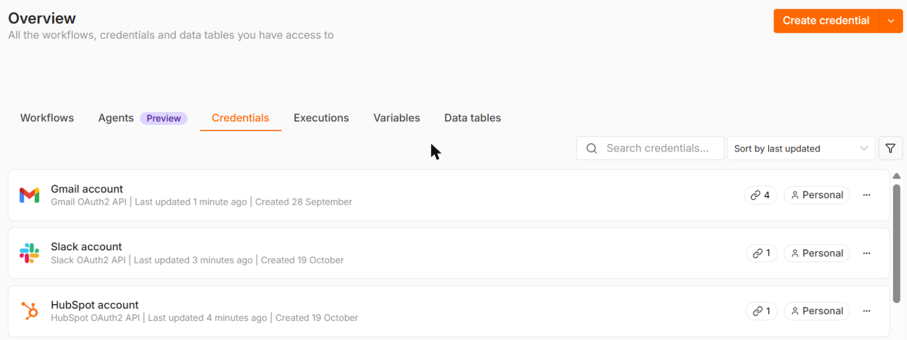
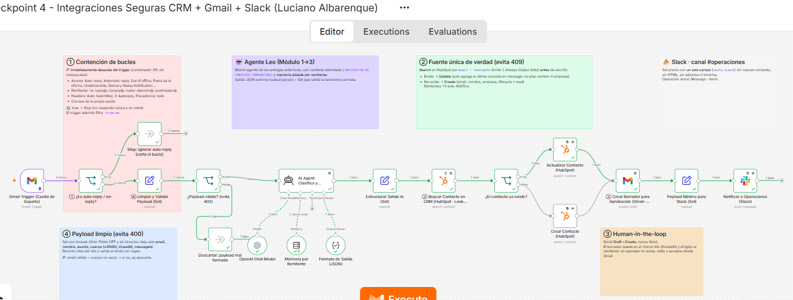
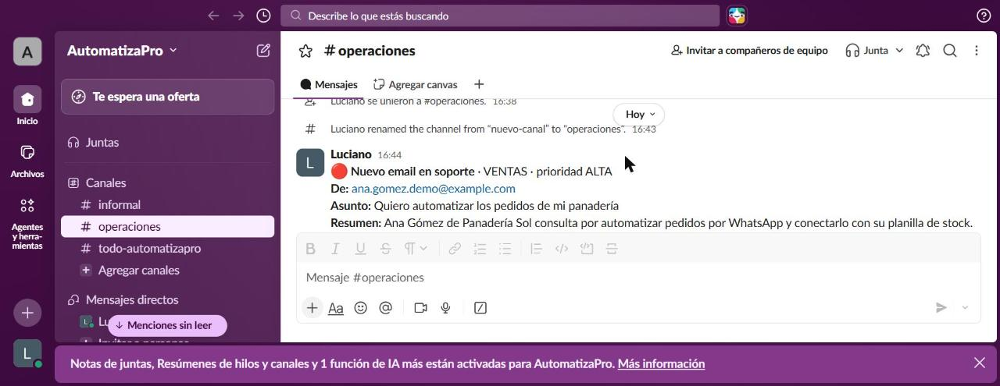

ENTREGA 4*

Integraciones seguras: CRM + Gmail + Slack

**Entregable:** [`checkpoint4_luciano_albarenque.json`](checkpoint4_luciano_albarenque.json) (n8n → Workflow → Download)

Es la evolución del proyecto integrador. El agente **Leo** (Entrega 1), la taxonomía cerrada del Router (Entrega 2) y el contexto delimitado con memoria aislada (Entrega 3) ahora atienden la **casilla de soporte de Gmail** y se conectan con tres herramientas reales del negocio vía **OAuth2**:

| Rol en el caso e-commerce | Herramienta | Credencial n8n | Operaciones usadas (mínimo privilegio) |
|---|---|---|---|
| CRM / fuente única de verdad | **HubSpot** | HubSpot OAuth2 | Contact › **Search** (lectura) y Contact › **Create or Update** (escritura) |
| Casilla de soporte | **Gmail** | Gmail OAuth2 | **Trigger** Message Received (lectura) y Draft › **Create** (escritura). Nunca *Send* |
| Canal del equipo de operaciones | **Slack** | Slack OAuth2 | Message › **Send** a `#operaciones` |

## Credenciales activas en n8n



---

## Arquitectura

```
[Gmail Trigger: email entrante]   (filtro: in:inbox -from:me, sin adjuntos)
        │
        ▼
① [IF ¿es auto-reply / no-reply?] ── true ─▶ [Stop: ignorar] (corta el bucle infinito)
        │ false
        ▼
④ [Set: limpiar y validar payload] → [IF ¿payload válido?] ── false ─▶ [Descartar] (evita el 400)
        │ true
        ▼
   [AI Agent "Leo": clasifica + redacta]  ← OpenAI gpt-4.1 · Memoria por remitente · Output parser JSON
        │
        ▼
   [Set: estructurar salida IA]  (valida la taxonomía cerrada)
        │
        ▼
② [HubSpot Search: ¿el contacto ya existe?]  (Look up por email, límite 1)
   ┌────┴─────┐
   Sí          No
   ▼            ▼
[Update]    [Create contacto]   (el Look up evita el 409)
   └────┬─────┘
        ▼
③ [Gmail Draft › Create]  (borrador en el hilo para aprobación humana: HITL)
        │
        ▼
④ [Set: payload mínimo para Slack] → [Slack: aviso a #operaciones]
```


## Test de regresión manual

Ejecuté el workflow completo (*Execute Workflow*) con 4 emails simulados, cargados como *pin data* en el trigger, y lo corrí **dos veces seguidas** para probar el anti-duplicado:

| # | Email de prueba | Resultado esperado | Resultado |
|---|---|---|---|
| 1 | `Automatic reply: Consulta` con header `Auto-Submitted: auto-replied` | ① → Stop | ✅ |
| 2 | `Delivery Status Notification (Failure)` de `mailer-daemon@` | ① → Stop | ✅ |
| 3 | Lead de Ana Gómez (Panadería Sol, USD 1500, 3 semanas). **1.ª ejecución** | IA: `VENTAS` · `ALTA` → Search sin resultados → HubSpot **Create** → borrador en Gmail → Slack | ✅ |
| 4 | Remitente `sin-arroba` (email inválido) | ¿Payload válido? → Descartar (no llega a la IA ni al CRM) | ✅ |
| 5 | El mismo email de Ana. **2.ª ejecución** | Search **encuentra** el contacto → **Update** (no se duplica) → borrador → Slack | ✅ |

**Ejecución 1:**  Slack devolvió `channel_not_found` porque el canal todavía no existía. Gracias a *On Error → Continue*, el contacto y el borrador se crearon igual. Después de crear `#operaciones`, la 2.ª ejecución terminó toda en verde.

**Ejecución 2: rama Update en verde, sin contactos duplicados**


**Aviso recibido en Slack `#operaciones`** (payload mínimo, sin el cuerpo del email)

